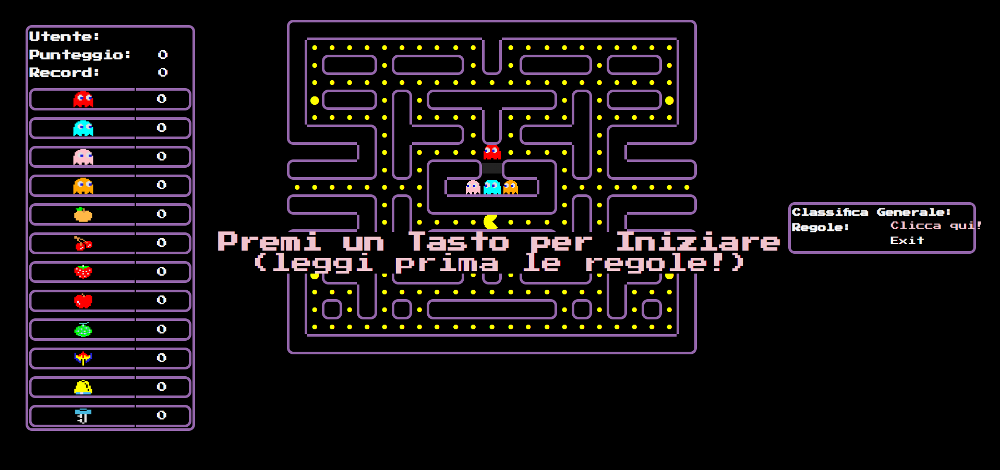

# 🟡 Pac-Man

Implementazione web full-stack di una versione arcade ispirata a **Pac-Man**, sviluppata interamente in **JavaScript** per la logica di gioco e animazione a sprite, affiancata da un backend **PHP e MySQL** per l'autenticazione degli utenti, il salvataggio delle partite e la classifica globale dei punteggi.

Sviluppato da **Marco Pio Spicuzza** per il corso di **Progettazione Web** presso l'**Università di Pisa** (Corso di Laurea Triennale in Ingegneria Informatica).



---

## 📌 Panoramica

Il progetto separa nettamente la presentazione, la logica di gioco lato client e la persistenza dei dati lato server:

* **Motore di Gioco Client-Side:**
  * Gestione della griglia/labirinto, collisioni con i muri, raccolta punti/bonus e gestione delle vite.
  * Animazione fluida dei personaggi e dei fantasmi tramite fogli di sprite dedicati (`Sprite/`) e font arcade personalizzati (`Font/`).
  * Controlli da tastiera reattivi e gestione degli stati di gioco (inizio partita, pausa, game over, vittoria).
* **Backend & Persistenza:**
  * Registrazione e login degli utenti con gestione delle sessioni PHP.
  * Salvataggio automatico dei punteggi al termine di ogni partita tramite chiamate asincrone al server.
  * Classifica generale (*Leaderboard*) e storico delle partite pregresse dell'utente.
* **Versione Client-Only Standalone (`HTML/pacman - copia.html`):**
  * Oltre all'applicazione completa con backend PHP/MySQL (`index.php`), la cartella `HTML/` include una versione puramente client-side (`pacman - copia.html`) priva di logica PHP, utile per testare immediatamente il motore di gioco nel browser senza configurare un server web.
* **Standard Web & Portabilità:**
  * Codice **HTML5** e **CSS3** validato secondo gli standard W3C (W3C Markup & CSS Validation Service).
  * Testato e compatibile su **Google Chrome** e **Mozilla Firefox**.
  * Manuale utente integrato direttamente nell'interfaccia web del gioco.

---

## 🗂️ Struttura della Repository

```text
pacman-pw/
├── CSS/                            # Fogli di stile CSS3
├── Database/                       # Dump SQL per la creazione del DB e delle tabelle
├── Docs/
│   ├── screenshot.png              # Anteprima grafica del gameplay
│   └── specifiche-progetto-v1.2.pdf # Specifiche ufficiali del corso
├── Font/                           # Font PressStart2p-Regular
├── HTML/
│   └── pacman - copia.html         # Versione standalone solo HTML/CSS/JS (senza backend PHP)
├── Javascript/                     # Moduli JS
├── PHP/                            # Endpoint server-side (login, registrazione, salvataggio score, classifica)
├── Sprite/                         # Asset grafici
├── index.php                       # Entry point principale dell'applicazione full-stack
└── README.md
```

---

## 📄 Documentazione

* 📋 **[Specifiche del Progetto d'Esame (PDF)](Docs/specifiche-progetto-v1.2.pdf)**
